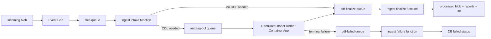

# Azure infrastructure

Use the environment-specific deploy scripts to provision Azure resources.
For an existing .NET 8 environment, follow the
[first .NET 10 rollout](#first-net-10-rollout) before running any deployment below.

## Deploy (dev)

1. Log in to Azure:

```bash
az login
```

2. Export the SQL admin password and run the script:

```bash
export SQL_ADMIN_PASSWORD='your-strong-password'
./infrastructure/azure/scripts/deploy_dev.sh
```

## Deploy (test)

```bash
export SQL_ADMIN_PASSWORD='your-strong-password'
./infrastructure/azure/scripts/deploy_test.sh
```

## Deploy (prod)

```bash
export SQL_ADMIN_PASSWORD='your-strong-password'
./infrastructure/azure/scripts/deploy_prod.sh
```

## Notes

- The script expects Azure CLI to be installed and will fail fast if it is missing.
- The wrapper scripts set defaults for subscription, resource group, and environment for each target (`dev`, `test`, `prod`).
- The web app uses `DOTNETCORE|10.0`. The ingest Function uses the .NET 10
  isolated worker on Flex Consumption with Functions runtime v4. The first
  upgrade requires updated Bicep and matching packages within the maintenance
  window described below. Keep `deployInfra` enabled for that rollout.
- The OpenDataLoader image uses .NET 10 on Ubuntu 24.04 with Java 17 and
  Python 3. Rebuild and deploy it along with the web and Function packages.

## First .NET 10 rollout

The rollout accepts minor downtime for the web app and ingest processing.
Allow a maintenance window for the whole deployment and recovery. The current
pipeline applies Bicep, builds and pushes the OpenDataLoader image, reapplies
infrastructure, sets app settings, deploys the web package, and finally deploys
the Function package. Both runtime settings can change while .NET 8 packages
are still installed. Web requests can fail, and intake, finalization, and failure
processing can stop until compatible packages are running. The interruption is
not limited to an app restart; any intermediate failure can extend it until an
operator completes deployment or rolls back. There is no automatic rollback.

This also applies to direct `deploy.sh` calls and the dev/test/prod wrappers.
Both the base deployment and the Event Grid retry pass apply the full template.
The OpenDataLoader deployment also reapplies it, even with `deployInfra=false`
in the pipeline. Neither `DEPLOY_EVENTGRID_SUBSCRIPTION=false` nor deploying
only an image isolates the runtime change. Do not use these paths for unrelated
infrastructure work during the first transition.

### Prepare and deploy

1. Assign an operator and a recovery deadline within the maintenance window.
   Rehearse in TEST first and use its measured duration to plan production.
   Before starting the main-branch pipeline, ensure the production environment
   has an approval gate so `Deploy_Prod` waits for the TEST checks below.
2. Retain the last working release's `webapp.zip` and `functionapp.zip`, its
   commit/build ID, and the deployed OpenDataLoader image digest. Keep the
   rollback packages locally available. Record the subscription, resource group,
   app names, runtime settings, and effective app settings, including
   `INGEST_AUTOTAG_PROVIDER`. Store settings containing secrets securely.
   Confirm .NET 8 remains available as a rollback target in the target region.
3. Confirm the .NET 10 build and package validation succeeded before starting
   the window. Keep `deployInfra=true`, deploy the same release to TEST and then
   production, and monitor every deployment task. For a manual rollout, prepare
   both packages and the image first, apply Bicep, then deploy both packages and
   the image within the same window. The infra scripts never publish either
   application package; the Function-only publish command below cannot complete
   the web upgrade.
4. Check the configured runtimes and application behavior before ending the
   window. Set `RESOURCE_GROUP`, `WEB_APP`, and `FUNCTION_APP` to the recorded
   target names and explicitly select the intended Azure subscription:

   ```bash
   az webapp config show -g "$RESOURCE_GROUP" -n "$WEB_APP" --query linuxFxVersion -o tsv
   az functionapp runtime config show -g "$RESOURCE_GROUP" -n "$FUNCTION_APP"
   ```

   Expect `DOTNETCORE|10.0` and `dotnet-isolated` version `10.0`. Verify `/health`
   returns healthy, sign in, and open an existing PDF. Check Function startup
   logs for `ProcessQueueMessage`, `FinalizeQueueMessage`, and
   `FailedQueueMessage`. In TEST, use controlled PDFs to verify intake, an actual
   OpenDataLoader conversion, final output/report creation, and terminal failure
   handling. After production deployment, monitor existing work or an approved
   sample through completion. Inspect active and dead-letter counts on `files`,
   `autotag-odl`, `pdf-finalize`, and `pdf-failed`. A successful deployment task
   or runtime-setting query alone does not establish recovery.

Microsoft's [language upgrade guidance](https://learn.microsoft.com/en-us/azure/azure-functions/update-language-versions)
recommends testing before changing the stack and notes that Flex Consumption
has no deployment slots. This procedure accepts the existing deployment order
and its interruption; it does not assume side-by-side .NET 8 support or introduce
another Function app consuming the same queues.

### Recover a failed or interrupted rollout

Stop the deployment and wait for its running tasks and Azure deployments to
finish before making recovery changes. Block automatic retries and production
promotion. Inspect the actual runtime, package, image, and settings state even
if the infrastructure task failed, because some resource updates may have
succeeded. If the cause can be corrected before the recovery deadline, complete
deployment of the same approved .NET 10 artifacts and repeat the checks above.
Otherwise restore the previous release as follows.

For a rollback to .NET 8, set `PREVIOUS_WEB_ZIP` and `PREVIOUS_FUNCTION_ZIP` to
the retained package paths. Restore each affected app's runtime and package
together, including an app whose package deployment never ran. Use the
[Flex runtime command](https://learn.microsoft.com/en-us/cli/azure/functionapp/runtime/config#az-functionapp-runtime-config-set)
for the Function's `functionAppConfig.runtime.version`; its Functions host stays
on v4. Do not use the web app's `linuxFxVersion` setting for the Flex Function.

```bash
az webapp config set -g "$RESOURCE_GROUP" -n "$WEB_APP" --linux-fx-version 'DOTNETCORE|8.0' -o none
az webapp deploy -g "$RESOURCE_GROUP" -n "$WEB_APP" --src-path "$PREVIOUS_WEB_ZIP" --type zip
az functionapp runtime config set -g "$RESOURCE_GROUP" -n "$FUNCTION_APP" --runtime-version 8.0 -o none
az functionapp deployment source config-zip -g "$RESOURCE_GROUP" -n "$FUNCTION_APP" --src "$PREVIOUS_FUNCTION_ZIP" --build-remote false
```

If the OpenDataLoader image changed, set `ODL_APP` to the existing Container App
and `PREVIOUS_ODL_IMAGE` to the retained digest reference, then restore it:

```bash
az containerapp update -g "$RESOURCE_GROUP" -n "$ODL_APP" --image "$PREVIOUS_ODL_IMAGE" -o none
```

Restore any changed app settings from the recorded configuration and approved
secret source, including the previous ingest provider. Repeat the runtime and
behavior checks above, expecting .NET 8 and the retained image after rollback.
Keep the maintenance window open if recovery fails. Preserve queued work and
inspect retries and dead letters before replaying anything; the interruption
does not guarantee every in-flight message completes successfully.

Do not rerun the .NET 10 Bicep or deployment scripts after rollback: they would
restore the .NET 10 runtime settings over the old packages. Keep deployments
paused until a corrected rollout is approved. This framework rollback requires
no database migration or queue-contract change.

## Deploy function code (ingest)

The infra deployment provisions the Function App, but does not publish code to it.

1. Find the Function App name:

```bash
az functionapp list -g rg-readable-dev --query "[].name" -o tsv
```

2. Publish the function from this repo:

```bash
cd workers/function.ingest
func azure functionapp publish <FUNCTION_APP_NAME> --dotnet-isolated --nozip
```

## Deploy OpenDataLoader Worker Container App

The base Bicep deployment now provisions:

- an Azure Container Registry,
- a Container Apps environment,
- Service Bus queues for each ingest stage,
- and, once an image is supplied, the `opendataloader` worker Container App itself.

The queue-based ingest pipeline is:



Queue ownership:

- `files`: Event Grid upload events. Consumed by the ingest intake function.
- `autotag-odl`: OpenDataLoader autotag jobs. Consumed by the ODL worker Container App.
- `pdf-finalize`: staged PDFs ready for remediation/final upload. Consumed by the ingest finalize function.
- `pdf-failed`: terminal autotag failures. Consumed by the ingest failure function to mark the DB attempt/file failed.

For a first-time setup without an image yet, bootstrap the optional ACR and
Container Apps environment first:

```bash
export DEPLOY_OPEN_DATA_LOADER_INFRASTRUCTURE=true
./infrastructure/azure/scripts/deploy_dev.sh
```

After the base infra exists, build and push the worker image:

```bash
az acr login --name <ACR_NAME>
docker build -f workers/opendataloader.api/Dockerfile -t <ACR_LOGIN_SERVER>/opendataloader-api:<TAG> .
docker push <ACR_LOGIN_SERVER>/opendataloader-api:<TAG>
```

Then rerun the deploy script with the image reference:

```bash
export OPEN_DATA_LOADER_IMAGE='<ACR_LOGIN_SERVER>/opendataloader-api:<TAG>'
export DEPLOY_EVENTGRID_SUBSCRIPTION=false
./infrastructure/azure/scripts/deploy_dev.sh
```

The ODL worker has no public ingress. It reads `autotag-odl`, downloads the
source PDF from Blob Storage, runs `opendataloader-pdf`, writes the tagged PDF
and ODL report to storage, and sends a `pdf-finalize` message. On the final
configured delivery attempt, it sends a `pdf-failed` message instead of letting
the ODL job dead-letter without updating the database.

Get the worker name from deployment outputs:

```bash
az deployment group show \
  --resource-group <RESOURCE_GROUP> \
  --name <DEPLOYMENT_NAME> \
  --query "properties.outputs.openDataLoaderContainerAppName.value" \
  -o tsv
```

Inspect queue depth:

```bash
az servicebus queue show \
  --resource-group <RESOURCE_GROUP> \
  --namespace-name <SERVICE_BUS_NAMESPACE> \
  --name autotag-odl \
  --query "{active:countDetails.activeMessageCount, deadletter:countDetails.deadLetterMessageCount}"
```

Tail worker logs:

```bash
az containerapp logs show \
  --resource-group <RESOURCE_GROUP> \
  --name <OPEN_DATA_LOADER_CONTAINER_APP_NAME> \
  --follow
```

The worker scales from the `autotag-odl` queue. `openDataLoaderMaxReplicas`
caps global ODL concurrency, while `openDataLoaderMaxConcurrentConversions`
controls conversions per replica. Start conservatively with one conversion per
replica, then increase max replicas after observing CPU, memory, and conversion
latency.

To route new jobs back to Adobe, set the ingest autotag provider back to Adobe
and drain pending ODL work before scaling the worker down. Omitting
`OPEN_DATA_LOADER_IMAGE` selects Adobe in Bicep but leaves an existing Container
App in place. Neither action restores an earlier image or framework version;
use the [rollout recovery procedure](#recover-a-failed-or-interrupted-rollout)
for a .NET runtime/package rollback.

## Tail logs (no Application Insights)

```bash
az webapp log config -g rg-readable-dev -n <FUNCTION_APP_NAME> --application-logging filesystem --level information
az functionapp log tail -g rg-readable-dev -n <FUNCTION_APP_NAME>
```

You can also use the Function App "Log stream" blade in the Azure Portal.

## Trigger the pipeline

The Event Grid subscription is filtered to only fire when a `.pdf` is uploaded into the `incoming` container.

Upload a PDF:

```bash
az storage blob upload \
  --account-name <DATA_STORAGE_ACCOUNT_NAME> \
  --container-name incoming \
  --name sample.pdf \
  --file ./sample.pdf \
  --auth-mode login
```
